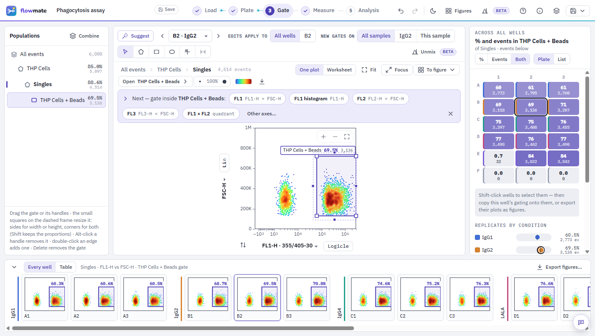

<p align="center"></p>

<h1 align="center">FlowMate</h1>

<p align="center"><strong>Free, open-source flow cytometry analysis that runs in your browser.</strong><br>
Gate every well of a plate at once, compensate, measure and graph with the statistics done —<br>
with nothing to install, and your data never leaving your computer.</p>

<p align="center">
<a href="https://rlshir302010-cpu.github.io/flowmate/app/"><b>Open FlowMate</b></a> ·
<a href="https://rlshir302010-cpu.github.io/flowmate/">Website</a> ·
<a href="VALIDATION.md">Validation</a> ·
<a href="CONTRIBUTING.md">Contribute</a> ·
<a href="mailto:rlshir302010@gmail.com">Contact</a>
</p>



## Why

Good flow cytometry software is often locked behind licences that many labs cannot afford, and that
gap decides whose data gets analysed well. FlowMate is a free alternative that a scientist can open
in a browser and trust: its numbers are checked against independent tools on public data, and the
checks — including what failed — are published here.

## What it does

FlowMate takes FCS files from raw data to a graph with the statistics done, in five steps:
**Load → Plate → Gate → Measure → Analysis**.

- **One gate, every well.** Polygon, rectangle, ellipse, quadrant and range gates, and And / Or / Not
  gates. Drag a gate and every well, a plate heat map and a filmstrip of all wells update live; adjust
  a single well where it needs it. Resize any gate by its width, its height or both.
- **Plates.** Paint conditions onto wells, mark controls, exclude a well with a reason. Tubes work too.
- **Compensation.** The files' matrix, one computed from single-stain controls, or an imported one.
  Spectral unmixing (beta).
- **Measure.** Counts, frequencies, median / mean / geometric mean, CV for any population, and
  formula columns.
- **Analysis.** Bar, dot, box or paired graphs with SD or SEM; t tests, one-way ANOVA, Tukey or
  Dunnett — and nested tests (a mixed model with the well as a random effect) that use every cell
  without counting cells as replicates. Same tests and numbers as GraphPad Prism.
- **Interoperability.** Import FlowJo 10 workspaces (.wsp) with a population-by-population comparison
  against FlowJo's counts; Gating-ML 2.0 in and out; CSV, PNG, SVG and an HTML report out.
- **Private.** Everything runs in the browser tab. Save analyses (with their data) in the browser,
  share one as a single file, or download FlowMate as one HTML file that works offline.

## Validation

Checked on published CC-BY data sets that were never used to build it, with the protocol and pass
criteria written before any result existed. Summary below; everything else in [VALIDATION.md](VALIDATION.md).

| What was checked | Against | Result |
|---|---|---|
| Reading FCS files (FCS 3.0 / 3.1; BD, Cytek) | FlowKit 1.3.2 | Bit-identical |
| Compensation, event by event | FlowKit · Beckman CytExpert | Equal to 6×10⁻⁸ · 1.2×10⁻⁷ |
| Gate counts on FlowJo workspaces (1,701 counts) | FlowKit 1.3.2 | 92 % exact or within 2 events / 0.1 % |
| FlowJo import: compensation and errors | — | 25/25 compensated · 0 hidden errors |
| Rule-based gating of a published experiment (11 tubes) | Paper's values (CytExpert) | All within 3 % |
| t tests, ANOVA, Tukey, Dunnett | GraphPad Prism 11 | Match Prism's printed digits |
| Nested (mixed-model) tests on cells | R nlme | Match to 1×10⁻⁵ |

## Run it yourself

No build step is needed to use it — open the [web app](https://rlshir302010-cpu.github.io/flowmate/app/),
or download [`docs/app/index.html`](docs/app/index.html) and open it from your disk.

To work on the code (plain JavaScript, no dependencies):

```bash
python FlowMate/build.py          # → FlowMate/dist/FlowMate.html
bash FlowMate/tests/run_all.sh    # all test suites in headless Chrome (Node 22+ for the storage tests)
python tools/build_site.py        # the website, into docs/
```

## Make it yours, or build it with me

FlowMate is made by **Shir Harel** and released under the [MIT licence](LICENSE): copy it, change it,
use it in your lab or your course. If you'd rather build it together — new features, more
instruments, validation on your data — email **[rlshir302010@gmail.com](mailto:rlshir302010@gmail.com)**
or open an [issue](https://github.com/rlshir302010-cpu/flowmate/issues). See [CONTRIBUTING.md](CONTRIBUTING.md).

## Citing

If FlowMate helps your work, please cite it — GitHub's "Cite this repository" button uses
[CITATION.cff](CITATION.cff).

---

FlowJo is a trademark of its owner. FlowMate is independent and not affiliated with or endorsed by
FlowJo or BD. FlowMate's FlowJo import follows FlowKit's (BSD-3) reading of the format; the public
test files in `FlowMate/tests/public` come from FlowKit and the Gating-ML 2.0 compliance suite.
